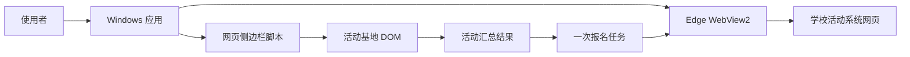
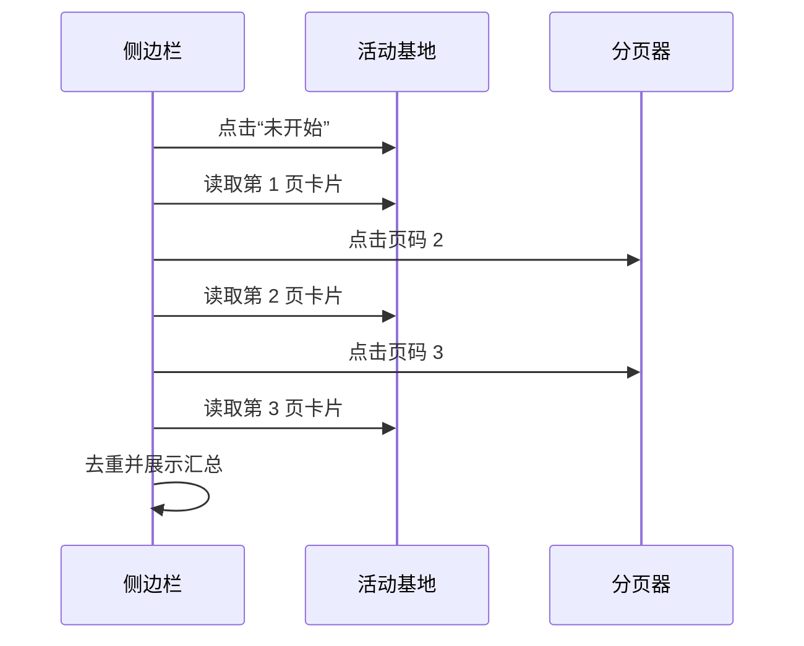
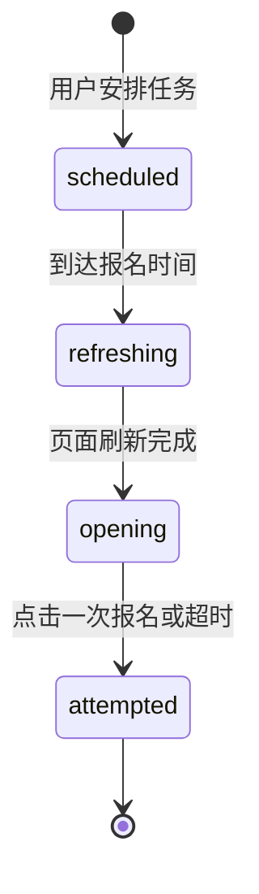

# 广轻活动汇总（Edge）设计文档

## 1. 项目概述

广轻活动汇总是一个 Windows 桌面辅助程序。程序使用系统 Microsoft Edge WebView2 打开学校活动系统，并在网页左侧注入本地侧边栏，用于汇总活动基地中“未开始”的活动、读取某一活动的报名时间，以及安排一次正常页面报名操作。

程序不替代学校系统：登录、资格判断、名额分配、验证码和最终报名结果均由学校网站处理。

## 2. 设计目标

1. 复用学校网页的正常登录状态，不保存账号密码。
2. 只读取“活动基地”区域的“未开始”活动，不混入首页的官方预告、热门活动等卡片。
3. 依据活动基地的分页控件，依次读取所有可见页码。
4. 让用户可选择一项活动，并从详情页读取报名开始时间。
5. 在指定报名时间执行一次正常页面刷新和一次报名点击。
6. 提供折叠侧边栏、页面恢复、返回活动广场和明确状态提示。

## 3. 总体架构



应用本体由 Python 和 pywebview 构成，打包为 Windows onedir 程序。网页侧边栏是运行在当前页面中的 JavaScript；它只读取已经显示的 DOM，并通过页面已有按钮完成正常交互。

## 4. 页面与交互设计

### 4.1 侧边栏

侧边栏固定在页面左侧，支持“收起 / 展开”。包含以下区域：

| 区域 | 功能 |
| --- | --- |
| 页面控制 | 重新打开学校页面、刷新当前页面、返回活动广场 |
| 活动读取 | 读取活动基地的未开始活动 |
| 选择结果 | 显示已选择活动、读取详情页报名时间 |
| 报名任务 | 显示一次报名时间、确认选项和任务状态 |

“返回活动广场”优先调用浏览器历史返回，从活动详情返回列表页；没有历史页时才跳回学校活动系统首页。

### 4.2 活动汇总弹层

活动读取后在网页上方显示结果弹层，字段包括：

- 活动名称
- 活动时间
- 具体地点
- 选择按钮

选择一项后，结果弹层关闭，侧边栏记录活动标题，并允许读取详情页报名时间。

## 5. 活动读取设计

### 5.1 读取范围

程序定位标题为“活动基地”的页面容器，并在该容器中点击“未开始”状态。卡片只从活动基地容器及其下方的卡片网格中提取。

以下首页区块不参与读取：

- 官方活动预告
- 大家热门
- 倒计时活动
- 其它首页推荐区块

### 5.2 分页读取

活动基地底部显示“共 N 条”和数字页码，例如 `1、2、3`。读取流程如下：



分页最多读取 10 页，避免页面结构异常时无止境点击。活动标题作为去重键；活动日期早于当天的卡片不加入结果。

### 5.3 班级活动处理

活动基地卡片若已显示“班级活动”文本，会在汇总前排除。部分活动的性质只在详情页中出现，这类信息不在列表页面 DOM 中；程序不会逐项自动打开全部详情页进行批量扫描，以避免对学校网站产生额外页面访问。

## 6. 一次报名任务设计

### 6.1 状态机



### 6.2 执行步骤

1. 用户在活动详情页读取“活动报名时间”。
2. 程序将开始时刻写入本地浏览器存储。
3. 到达开始时刻时，程序刷新当前详情页一次。
4. 页面加载后，程序最多等待 15 秒，检查报名按钮是否由“报名未开始”变为可点击的“报名”或“立即报名”。
5. 按钮可用时只点击一次；如用户勾选确认选项，再尝试一次确认。
6. 任务标记为已尝试，不进行循环重试。

任务只能在程序保持运行、学校登录状态仍有效、网络可用且电脑未休眠时执行。

## 7. 数据模型

### 7.1 活动记录

```text
Activity {
  title: string,
  time: string,
  location: string
}
```

### 7.2 一次报名任务

```text
SignupTask {
  state: scheduled | refreshing | opening | attempted,
  title: string,
  at: ISO-8601 datetime,
  autoConfirm: boolean,
  refreshedAtStart?: ISO-8601 datetime,
  attemptedAt?: ISO-8601 datetime
}
```

报名任务保存在当前 WebView 的 `localStorage` 中；详情页报名时间读取状态保存在 `sessionStorage` 中。

## 8. 异常与恢复设计

| 场景 | 处理方式 |
| --- | --- |
| 学校页面空白 | 侧边栏提供“刷新当前页面”和“重新打开学校页面” |
| 详情页无法回到列表 | “返回活动广场”调用正常浏览历史返回 |
| 本地数据目录被拒绝访问 | 依次使用用户 LocalAppData、程序目录、系统临时目录 |
| 未找到活动基地 | 提示用户回到活动广场并滚动至活动基地 |
| 报名按钮未出现 | 最多等待 15 秒后停止并提示查看学校页面 |
| 同时启动多个程序 | 使用 Windows 互斥体，后启动实例聚焦已有窗口 |

## 9. 安全与资源边界

- 不调用学校未公开接口。
- 不保存学校账号密码。
- 不批量提交报名。
- 不循环重试报名。
- 报名开始时最多刷新当前详情页一次。
- 不绕过验证码、资格限制或学校页面的其它访问控制。

## 10. 打包与发布

发布包采用 onedir 结构：

```text
广轻活动汇总-Edge-v4.x-windows-x64.zip
└─ 广轻活动汇总-Edge/
   ├─ 广轻活动汇总-Edge.exe
   └─ _internal/
```

使用者必须完整解压后运行 EXE，不能仅复制 EXE 文件。发布前需要验证：Python 语法、WebView 脚本注入、发行目录中的 EXE 和 `_internal` 文件夹，以及 ZIP 文件内容。
